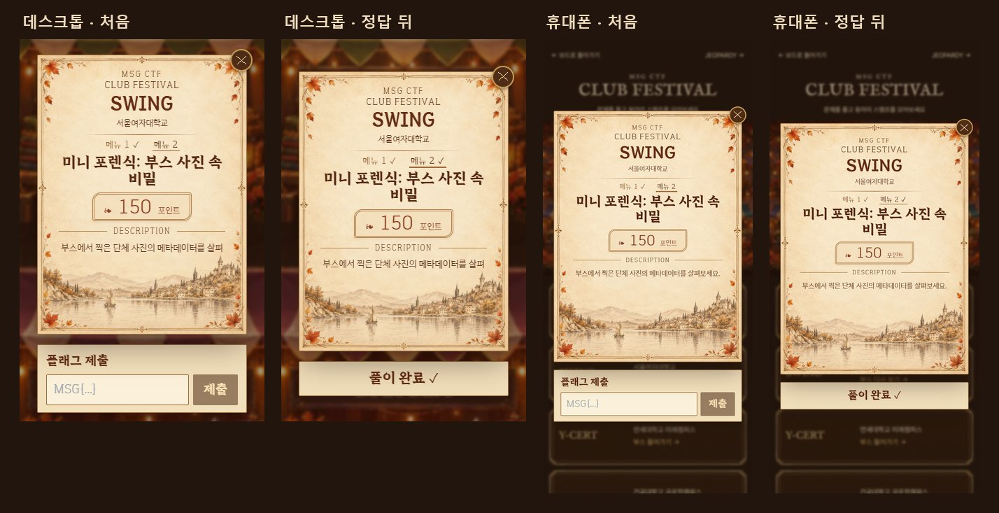
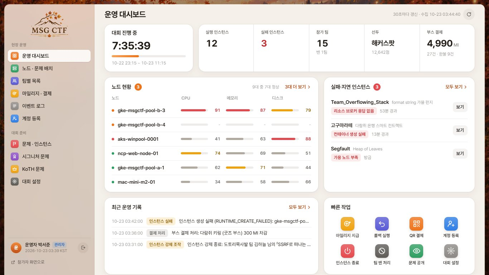
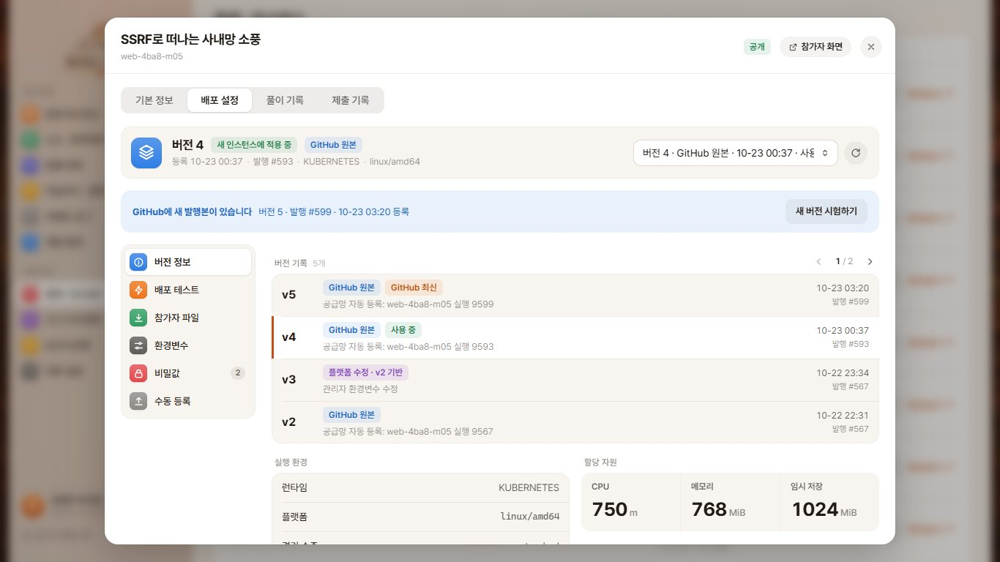
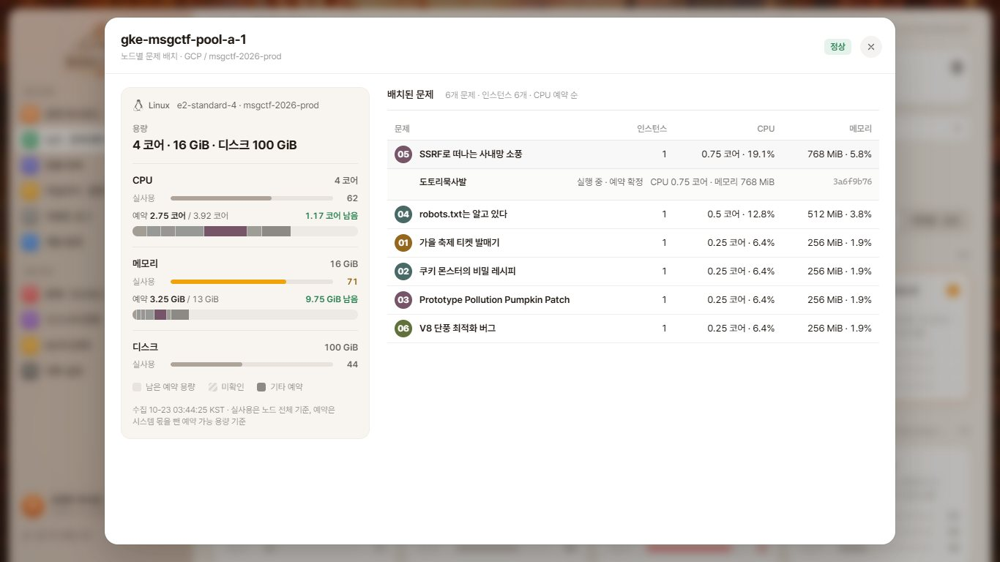
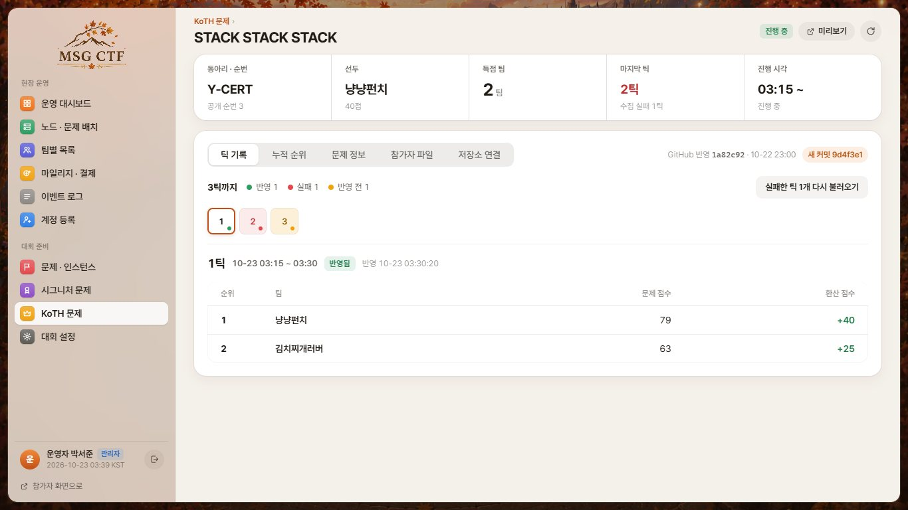

<h1>MSG CTF · Frontend</h1>

참가자 화면 · 관리자 콘솔

<a href="https://msg-ctf.github.io/platform.html">플랫폼</a> · <a href="#development">개발 문서</a>

<h2 align="center">Overview</h2>

### Participant

<table align="center">
<tr><th width="400">Board</th><th width="400">Challenge</th></tr>
<tr><td>3D 주사위 · 이동 · 찬스카드</td><td>문제 지문 · 파일 · 실행 · 정답 제출</td></tr>
<tr><th width="400">Challenge List</th><th width="400">KOTH</th></tr>
<tr><td>보드에서 열린 문제 확인</td><td>문제별 접속 · 경기 · 점수</td></tr>
<tr><th width="400">Club Festival</th><th width="400">My Page</th></tr>
<tr><td>동아리 부스 · 시그니처 문제</td><td>팀 점수 · 마일리지 · 풀이 기록</td></tr>
</table>

규칙 · 부스 화면 더 보기

<table align="center">
<tr><th width="400">Rules</th><th width="400">Booth</th></tr>
<tr><td>대회 규칙과 보상 안내</td><td>데스크톱 · 모바일 문제 제출</td></tr>
</table>

### Admin

<table align="center">
<tr><th width="400">Dashboard</th><th width="400">Releases</th></tr>
<tr><td>서비스 · 노드 · 인스턴스 현황</td><td>문제별 배포 버전 · 실행 환경</td></tr>
<tr><th width="400">Nodes</th><th width="400">KOTH Scoring</th></tr>
<tr><td>노드 자원 · 실행 중인 문제</td><td>수집 틱 · 순위 · 점수 확인</td></tr>
</table>

[웹에서 둘러보기](https://msg-ctf.github.io/platform.html#platform)

<h2 align="center">Contributors</h2>

<table align="center">
<tr><th align="center" colspan="12"><a href="https://github.com/MSG-CTF/front-team">Frontend</a></th></tr>
<tr>
<td align="center" valign="top" colspan="6" width="390"> <a href="https://github.com/tortoiese"><b>tortoiese</b></a> 참가자·관리자 UI API 연결·타이머</td>
<td align="center" valign="top" colspan="6" width="390"> <a href="https://github.com/yes0r"><b>yes0r</b></a> 보드·3D KOTH·순위·부스 화면</td>
</tr>
<tr><th align="center" colspan="8"><a href="https://github.com/MSG-CTF/jm_devsecops/tree/main">DevSecOps</a></th><th align="center" colspan="4"><a href="https://github.com/MSG-CTF/secure-provisioner/tree/dev">Runtime</a></th></tr>
<tr>
<td align="center" valign="top" colspan="4" width="260"> <a href="https://github.com/Giheon-Jeon"><b>Giheon-Jeon</b></a> 프론트 CI API 프록시·보안 검사</td>
<td align="center" valign="top" colspan="4" width="260"> <a href="https://github.com/woalseee"><b>woalseee</b></a> 실행 환경 VM 자동 배포</td>
<td align="center" valign="top" colspan="4" width="260"> <a href="https://github.com/goldsimchoi"><b>goldsimchoi</b></a> TCP·TLS 접속 안내 이미지 준비 화면</td>
</tr>
<tr><th align="center" colspan="8"><a href="https://github.com/MSG-CTF/msg-backend">Backend</a></th><th align="center" colspan="4"><a href="https://github.com/MSG-CTF">PM</a></th></tr>
<tr>
<td align="center" valign="top" colspan="4" width="260"> <a href="https://github.com/dnehdx"><b>dnehdx</b></a> 팀 정보·분야별 순위 CSP 적용</td>
<td align="center" valign="top" colspan="4" width="260"> <a href="https://github.com/jiwonnii"><b>jiwonnii</b></a> 주사위 연속 사용 충전 규칙 안내</td>
<td align="center" valign="top" colspan="4" width="260"> <a href="https://github.com/jongcoding"><b>jongcoding</b></a> 운영 QA·재시도 복구 다운로드·상품 결제</td>
</tr>
</table>

기여 기록 · 관련 PR

| 기여자 | 기여 내용 | 관련 PR |
| --- | --- | --- |
| [tortoiese](https://github.com/tortoiese) | 문제·보드·관리자 UI, API 연결, 타이머와 화면 디자인 | [#8](https://github.com/MSG-CTF/front-team/pull/8) · [#26](https://github.com/MSG-CTF/front-team/pull/26) · [#288](https://github.com/MSG-CTF/front-team/pull/288) |
| [yes0r](https://github.com/yes0r) | 보드·KOTH·순위·마이페이지, 동아리 부스와 3D 화면 구성 | [#1](https://github.com/MSG-CTF/front-team/pull/1) · [#14](https://github.com/MSG-CTF/front-team/pull/14) · [#247](https://github.com/MSG-CTF/front-team/pull/247) |
| [Giheon-Jeon](https://github.com/Giheon-Jeon) | 프론트 CI, Nginx API 프록시와 의존성 보안 검사 | [#17](https://github.com/MSG-CTF/front-team/pull/17) · [#35](https://github.com/MSG-CTF/front-team/pull/35) · [#36](https://github.com/MSG-CTF/front-team/pull/36) |
| [woalseee](https://github.com/woalseee) | 프론트 실행 환경과 개발 VM 자동 배포 | [#39](https://github.com/MSG-CTF/front-team/pull/39) · [#44](https://github.com/MSG-CTF/front-team/pull/44) · [#85](https://github.com/MSG-CTF/front-team/pull/85) |
| [goldsimchoi](https://github.com/goldsimchoi) | TCP·TLS·SNI 접속 안내와 관리자 이미지 준비 화면 | [#201](https://github.com/MSG-CTF/front-team/pull/201) · [#235](https://github.com/MSG-CTF/front-team/pull/235) · [#245](https://github.com/MSG-CTF/front-team/pull/245) |
| [dnehdx](https://github.com/dnehdx) | 팀 정보·분야별 순위 표시와 CSP 적용 | [#172](https://github.com/MSG-CTF/front-team/pull/172) · [#199](https://github.com/MSG-CTF/front-team/pull/199) · [#295](https://github.com/MSG-CTF/front-team/pull/295) |
| [jiwonnii](https://github.com/jiwonnii) | 주사위 연속 사용과 충전 규칙 안내 | [#54](https://github.com/MSG-CTF/front-team/pull/54) |
| [jongcoding](https://github.com/jongcoding) | 운영 QA와 연동 보완, 재시도 복구·다운로드·관리자 상품 결제 | [#150](https://github.com/MSG-CTF/front-team/pull/150) · [#294](https://github.com/MSG-CTF/front-team/pull/294) · [#296](https://github.com/MSG-CTF/front-team/pull/296) |

<h2 align="center">Tech Stack</h2>

 &nbsp;  &nbsp;  &nbsp;  React · Vite · Tailwind CSS · Three.js JavaScript · React Router

## Development

- [관리자 화면](docs/admin-console.md)
- [배포 환경 설정](docs/deployment-broker.md)
- [인스턴스 오류 안내](docs/instance-reset-feedback.md)
- [화면·API 기획](AGENT.md)
- [설치·실행 안내](README.reference.md)

<a href="https://github.com/MSG-CTF/msg-ctf.github.io/blob/67e93a09ce630910f98ae56fb118ca1317af78e0/docs/tech-icons.md">아이콘 출처</a>

