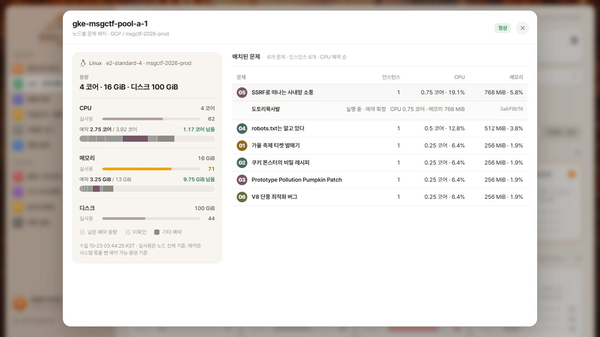
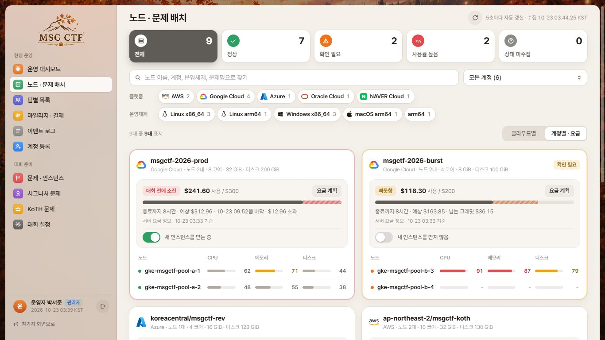
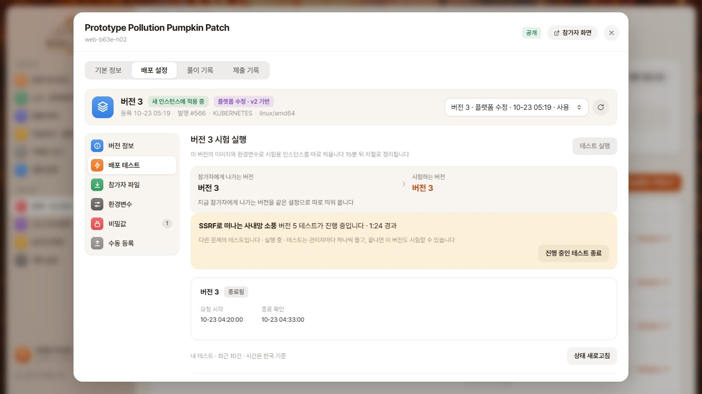
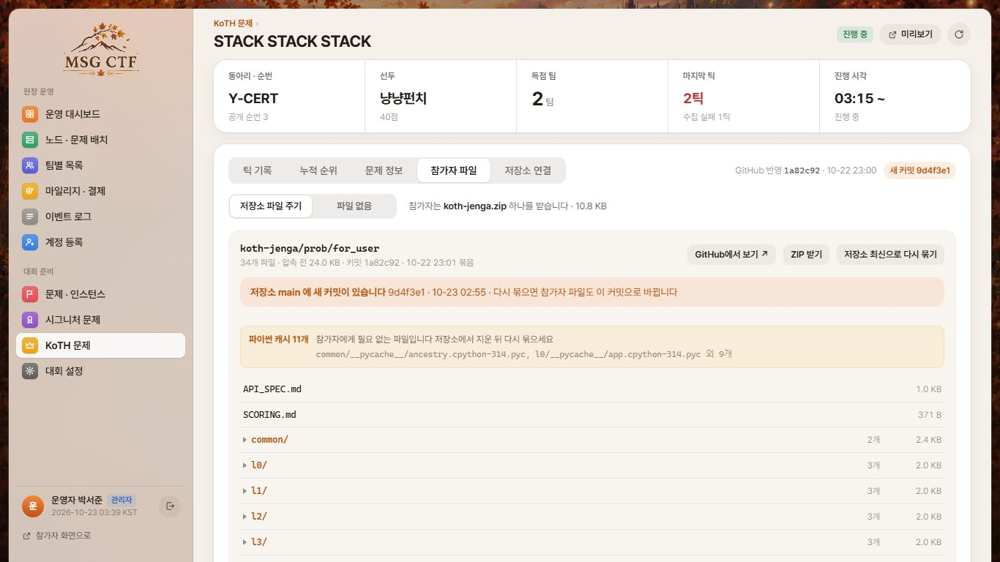
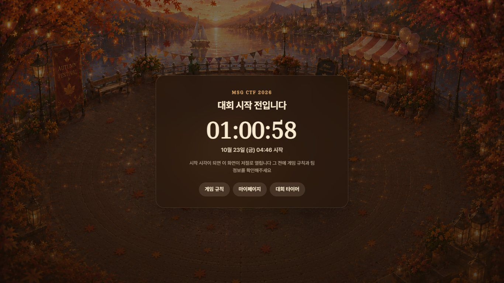

# 관리자 화면 안내

대회 당일 운영자가 노트북 한 화면에서 보는 순서대로 정리했다 화면 캡처는 목 서버 데이터다

## 운영 대시보드

대회 남은 시간, 실행·실패 인스턴스, 참가 팀, 선두, 부스 결제를 위에 두고 아래에 노드 현황, 실패·지연 인스턴스, 최근 운영 기록, 빠른 작업을 둔다 30초마다 갱신한다

## 노드 · 문제 배치

노드를 누르면 왼쪽에 용량, 실사용, 예약 막대가 오고 오른쪽에 배치된 문제 표가 온다 문제를 누르면 그 줄 아래에 팀별 인스턴스가 열린다 계정별 보기에서는 대회 종료까지 예상 요금과 새 배치 멈춤을 다룬다 응답 계약은 [admin-node-allocation.md](admin-node-allocation.md)

## 문제 배포 설정

버전마다 GitHub 원본, 플랫폼 수정, 이전 기록을 구분하고 GitHub에 가장 최근 올린 버전과 등록 시각을 보인다 버전 기록은 네 줄씩 넘긴다 새 버전은 참가자 버전을 그대로 둔 채 배포 테스트로 따로 띄워 본다 배포 테스트는 관리자마다 하나씩 돌아서, 다른 문제 테스트가 돌고 있으면 그 문제 이름과 버전을 보인다

## KoTH

틱마다 받은 순위와 환산 점수, 누적 순위, 문제 정보, 참가자 파일, 저장소 연결을 한 화면에서 다룬다 실패한 틱은 다시 불러오고, 저장소 main 에 새 커밋이 있으면 탭 위에 표시한다 요청 계약은 [admin-koth.md](admin-koth.md)

문제는 제오파디처럼 직접 쓰거나 저장소 koth 폴더에서 가져와 등록한다 동아리마다 하나씩, 공개 예정으로 만들고 문제 서버용 내부 토큰은 등록 직후 한 번만 보인다

## 대회 시작 전 참가자 화면

시작 전에는 보드, 문제, 시그니처, KoTH, 순위표 대신 카운트다운을 보이고 시작 시각이 되면 바로 연다 규칙, 마이페이지, 타이머와 관리자 계정은 그대로 들어간다

