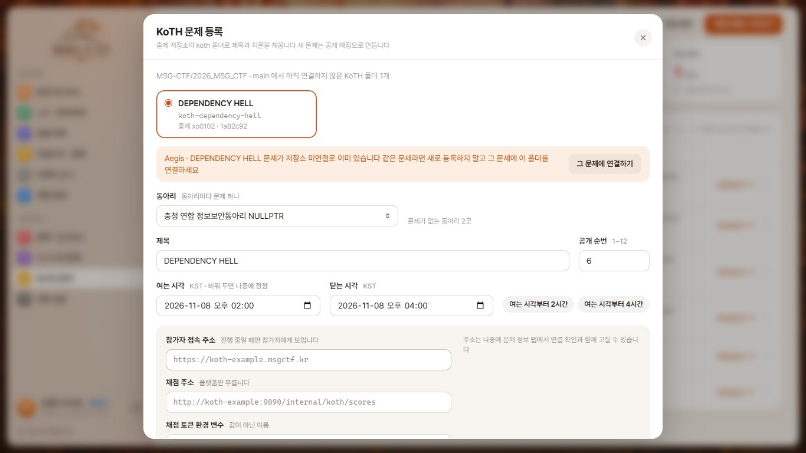
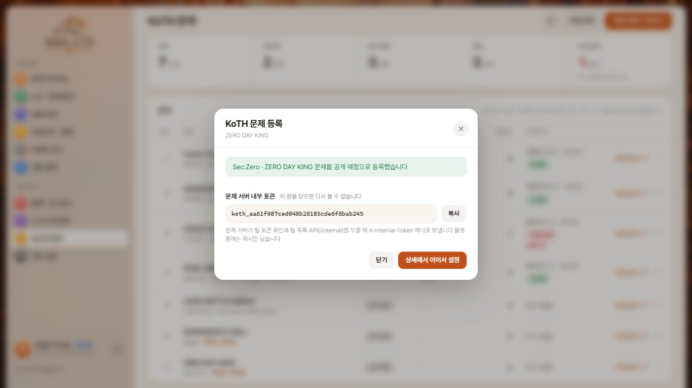

# 관리자 KoTH 화면과 요청 계약

2026-10-23 KST 확인 기준

- 프론트 화면: /admin/koth (목록), /admin/koth/{koth_challenge_id} (상세), /admin/koth/{koth_challenge_id}/preview (참가자 화면 미리보기)
- 확인한 백엔드 main: ab849ff (MSG-CTF/msg-backend)
- 확인한 문제 저장소 main: 84742c5 (MSG-CTF/2026_MSG_CTF)
- 아래 관리자 API는 프론트 요청이며 백엔드에는 아직 없다 화면은 목업으로 먼저 맞췄다

## 지금 백엔드에 있는 것

- 모델: KothClub, KothChallenge(title, challenge_url, status, open_group, opened_at, closed_at, score_api_url, score_api_token_env), KothSolve(earned_score, solved_at), KothScorePeriod(period_id, status PENDING|APPLIED|FAILED, attempts, response_payload, last_error, applied_at)
- 참가자 API: GET /koth/clubs, GET /koth/clubs/{club_id}, GET /koth/me, GET /koth/leaderboard?koth_challenge_id=, GET /koth/team_token (모두 Bearer)
- 채점: poll_koth_scores 명령이 15분 구간마다 문제 서버 GET /internal/koth/scores 를 불러 period_rank 를 점수로 바꾼다
- 구간(period_id)은 정각 기준 15분 칸이다 parse_period 가 분이 0, 15, 30, 45 가 아니면 거부한다
- 실패하거나 반영 전인 구간은 poll_koth_scores --period-id 로 다시 부를 수 있다 명령은 ACTIVE 문제만 돈다
- 관리자 등록과 편집은 Django 관리자(/admin/)에서만 된다 지문(description) 칸은 모델에 없다
- 문제 서버는 플랫폼의 /internal/koth/team_tokens/verify, /internal/teams 를 koth_challenge_id 와 X-Internal-Token 헤더로 부른다 플랫폼은 그 토큰의 sha256 만 inbound_internal_token_hash 에 둔다

## 화면 동작

- 화면은 15분 구간을 틱이라고 부른다 문제를 연 시각이 든 칸이 1틱이고, 그 뒤 15분마다 2틱, 3틱으로 센다
- 목록: 공개 순번 순서로 상태, 선두 팀과 점수, 득점 팀 수, 마지막 틱과 수집 상태, 저장소 연결 여부를 한 줄씩 보인다
- 등록: 목록 위 직접 등록과 저장소에서 가져오기
  - 동아리마다 문제는 하나라 문제가 없는 동아리만 고르거나 새 동아리 이름을 쓴다 새 문제는 공개 예정으로 만든다
  - 저장소에서 가져오면 아직 연결하지 않은 koth-* 폴더를 골라 info.yaml 이름과 지문을 채우고, 채점 토큰 이름은 KOTH_폴더이름_TOKEN 으로 제안한다
  - 같은 이름 문제가 저장소 미연결로 이미 있으면 새로 만들지 말고 그 문제의 저장소 연결 탭으로 보낸다
  - 문제 서버에 넣을 내부 토큰 원문은 등록 직후 한 번만 보인다 상세에서 이어서 설정하면 문제 정보 탭부터 연다
- 상세 탭
  - 틱 기록: 1틱부터 마지막 틱까지 상태 색으로 칠한 번호 칸을 한 줄로 보이고, 고른 틱의 순위, 문제 점수(metric_score), 환산 점수를 아래에 보인다 실패한 틱과 끝났는데 반영 전인 틱은 하나씩 또는 한 번에 다시 불러온다 100틱이 넘으면 이전 틱 쪽을 이어 붙인다
  - 누적 순위: GET /koth/leaderboard (구현 완료) 그대로, 위에 점수 환산 표를 둔다
  - 문제 정보: 제목, 공개 순번, 상태, 여는 시각과 닫는 시각, 참가자 접속 주소, 채점 주소와 토큰 환경 변수 이름, 지문을 고치고 사유를 남긴다 바뀐 칸만 보낸다 저장 전에 연결 확인으로 두 주소를 서버에서 불러 본다
  - 참가자 파일: 저장소 prob/for_user 폴더를 zip 하나로 묶어 주거나 파일 없이 접속 주소만 준다 캐시, 메타 파일, 환경 변수 파일처럼 섞이면 안 되는 파일을 따로 알린다
  - 저장소 연결: 문제 저장소의 koth-* 폴더를 골라 잇고, 원하면 info.yaml 이름과 지문을 가져온다
- 미리보기: 참가자 KoTH 지도와 문제 정보 칸을 저장된 내용으로 연다 아직 공개 전이거나 끝난 문제도 진행 중일 때 모습으로 보이고, 팀 토큰, 문제 접속, 파일 받기는 막는다
- 관리자 API가 없으면(404, 405, 501) 참가자 API로 목록과 누적 순위만 보이고 나머지 탭은 반영 전 안내를 보인다

## 점수 환산 (백엔드 apps/koth/services.py 와 같음)

| 구간 순위 | 1위 | 2위 | 3위 | 4위 | 5위 | 6위부터 |
| --- | --- | --- | --- | --- | --- | --- |
| 환산 점수 | 40 | 25 | 15 | 12 | 8 | 0 |

- 공동 순위는 차지한 연속 순위의 점수를 합쳐 팀 수로 나누고 소수점을 버린다 예: 공동 1위 2팀은 (40 + 25) ÷ 2 = 32점씩
- 밴 팀은 구간 결과에서 빠진다
- 화면은 서버가 awarded_score 를 주면 그 값을, 없으면 같은 규칙으로 계산한 값을 보인다

## 요청 계약 (프론트 요청, 백엔드 PR 대기)

모두 관리자 Bearer 인증, 응답은 공통 봉투(code, message, data)

### GET /admin/koth/challenges

```json
{
  "challenges": [
    {
      "koth_challenge_id": "uuid", "club_id": "uuid", "club_name": "MJSEC",
      "title": "Grand Tour Duel", "description": "참가자에게 보일 지문",
      "status": "SCHEDULED | ACTIVE | CLOSED", "open_group": 1,
      "opened_at": "ISO | null", "closed_at": "ISO | null",
      "challenge_url": "https://... | null",
      "score_api_configured": true,
      "score_api_url": "https://... | null", "score_api_token_env": "KOTH_JENGA_TOKEN | null",
      "files": { "mode": "REPOSITORY | NONE", "bundle": { "file_name": "koth-jenga.zip", "size_bytes": 11059, "file_count": 34, "built_at": "ISO", "source_revision": "1a82c92" } },
      "current_owner_team_id": "uuid | null", "current_owner_team_name": "팀 | null", "current_score": 337,
      "scored_team_count": 9,
      "last_period": { "period_id": "ISO", "status": "APPLIED", "applied_at": "ISO | null" },
      "failed_period_count": 0,
      "repository": {
        "slug": "koth-grand-tour-duel", "source_revision": "713db5b", "author": "goldsimchoi",
        "committed_at": "ISO", "synced_at": "ISO",
        "latest_revision": "713db5b", "latest_committed_at": "ISO", "latest_author": "goldsimchoi",
        "source_url": "https://github.com/MSG-CTF/2026_MSG_CTF/tree/main/koth-grand-tour-duel"
      },
      "updated_at": "ISO", "updated_by": "운영자 박서준"
    }
  ],
  "total_count": 6,
  "scoring": { "period_minutes": 15, "points": [40, 25, 15, 12, 8] }
}
```

- challenge_url 은 상태와 상관없이 원문을 준다 (참가자 API는 ACTIVE 일 때만 준다)
- score_api_configured 는 score_api_url 과 토큰 환경 변수가 모두 있는지만 알린다
- score_api_url 과 score_api_token_env 는 모델에 이미 있는 칸이다 토큰 값은 서버 환경 변수에만 있고 응답에 넣지 않는다
- files.bundle 은 참가자가 받을 zip 이다 파일을 주지 않으면 null
- repository 는 연결 전이면 null
- 최신화: source_revision 은 플랫폼에 반영한 커밋, committed_at 은 그 커밋 시각, synced_at 은 플랫폼이 반영한 시각이다 latest_* 는 저장소 main 의 그 폴더 최신 커밋이다 화면은 둘이 다르면 탭 위와 목록에 새 커밋을 띄운다
- updated_by 는 문제 정보를 마지막으로 저장한 관리자 이름이다 문제 정보 탭 아래에 마지막 저장 시각과 함께 보인다

### POST /admin/koth/challenges

```json
{
  "club_id": "uuid", "club_name": "새 동아리 이름 (club_id 대신)",
  "title": "1~100자", "description": "지문", "open_group": 1,
  "opened_at": "ISO | null", "closed_at": "ISO | null",
  "challenge_url": "https://... | null", "score_api_url": "https://... | null", "score_api_token_env": "KOTH_JENGA_TOKEN | null",
  "repository_slug": "koth-jenga | null", "reason": "1~500자 필수"
}
```

- club_id 와 club_name 중 하나만 보낸다 KothChallenge 는 동아리마다 하나(uq_koth_challenge_club)라 club_id 는 문제가 없는 동아리만 받고, club_name 을 보내면 KothClub 을 같이 만든다
- 새 문제의 status 는 SCHEDULED 다 칸 규칙은 PATCH 와 같다
- repository_slug 를 보내면 PUT .../repository 처럼 그 폴더에 잇고 지금 main 커밋을 source_revision 으로 남긴다
- inbound_internal_token_hash 가 필수 칸이라 서버가 내부 토큰을 만들고 해시만 저장한다 원문은 이 응답의 internal_token 으로 한 번만 준다
- 응답은 201, 목록 항목과 같은 모양에 internal_token 을 더한다 운영 기록(AdminEvent)에 사유를 남긴다
- 오류: 400 INVALID_REQUEST, 404 CLUB_NOT_FOUND, 409 KOTH_CLUB_HAS_CHALLENGE, 409 KOTH_CLUB_NAME_TAKEN, 404 REPOSITORY_FOLDER_NOT_FOUND, 409 REPOSITORY_ALREADY_LINKED





### GET /admin/koth/challenges/{koth_challenge_id}

목록 항목과 같은 필드에 leaderboard(GET /koth/leaderboard 의 leaderboard 와 같은 줄)를 더한다 없는 문제는 404 KOTH_CHALLENGE_NOT_FOUND

### GET /admin/koth/challenges/{koth_challenge_id}/periods?page=1&size=100

```json
{
  "periods": [
    {
      "period_id": "2026-10-21T05:15:00Z", "status": "APPLIED", "attempts": 1, "last_error": "", "applied_at": "ISO | null",
      "results": [
        { "team_id": "uuid", "team_name": "도토리묵사발", "period_rank": 1, "metric_score": 166, "awarded_score": 40 }
      ]
    }
  ],
  "total_count": 16, "page": 1, "size": 100
}
```

- 최신 구간이 먼저 온다 KothScorePeriod 한 줄이 구간 하나다 size 는 100까지 받는다 화면은 이전 틱이 필요할 때 다음 page 를 불러 뒤에 붙인다
- results 는 response_payload.data.results 를 팀 이름과 함께 풀어 준다 수집 전이거나 실패한 구간은 빈 배열
- awarded_score 는 반영된 환산 점수 (밴 팀 0)

### PATCH /admin/koth/challenges/{koth_challenge_id}

```json
{
  "title": "1~100자", "description": "지문", "challenge_url": "https://... | null", "open_group": 1, "status": "ACTIVE",
  "opened_at": "ISO | null", "closed_at": "ISO | null",
  "score_api_url": "https://... | null", "score_api_token_env": "KOTH_JENGA_TOKEN | null",
  "reason": "1~500자 필수"
}
```

- 보낸 칸만 바꾼다 description 은 KothChallenge 에 새 칸이 필요하다
- opened_at, closed_at 은 공개 예정 시각과 마감 시각이다 closed_at 은 opened_at 보다 뒤여야 한다 (400 INVALID_REQUEST)
- score_api_url 은 http 또는 https, 계정 정보와 # 없이 받는다 score_api_token_env 는 영어 대문자로 시작하고 대문자, 숫자, _ 만 쓴다
- status 를 ACTIVE 로 바꾸면 opened_at 이 비어 있을 때 지금 시각을, CLOSED 로 바꾸면 closed_at 을 지금 시각으로 둔다
- 응답은 목록 항목과 같은 모양 운영 기록(AdminEvent)에 사유와 바뀐 칸을 남긴다
- 오류: 400 INVALID_REQUEST, 404 KOTH_CHALLENGE_NOT_FOUND

### POST /admin/koth/challenges/{koth_challenge_id}/connection_test

```json
{ "challenge_url": "https://koth-jenga.msgctf.kr | null", "score_api_url": "https://.../internal/koth/scores | null", "score_api_token_env": "KOTH_JENGA_TOKEN | null" }
```

저장 전 값으로 플랫폼 서버가 두 주소를 직접 불러 본다 아무것도 저장하지 않는다

```json
{
  "challenge": { "ok": true, "status": 200, "latency_ms": 83 },
  "score_api": { "ok": true, "status": 200, "latency_ms": 118, "result_count": 9 },
  "checked_at": "ISO"
}
```

- challenge 는 참가자 접속 주소에 GET 한 결과다 리다이렉트는 따라가지 않고 5초 안에 응답이 없으면 실패로 본다
- score_api 는 poll_koth_scores 와 같은 요청(현재 구간 period_id, 토큰 헤더)을 보내고 응답 모양까지 검사한다 result_count 는 받은 팀 결과 수
- 주소가 비어 있으면 { "ok": false, "skipped": true }, 실패면 { "ok": false, "status": 502, "error": "사람이 읽을 이유" }
- 토큰 환경 변수가 서버에 없으면 score_api 는 실패이고 error 에 변수 이름만 적는다 토큰 값은 어디에도 내보내지 않는다
- 내부 주소(localhost, 사설 대역)를 막을지는 백엔드 정책을 따른다

### POST /admin/koth/challenges/{koth_challenge_id}/periods/{period_id}/retry

본문 없음 실패했거나 끝났는데 반영 전인 구간 하나를 문제 서버에서 다시 받아 반영한다 poll_challenge_period 를 그 구간으로 부르는 것과 같다

- 응답은 periods 목록의 한 줄과 같은 모양 반영되면 status APPLIED, 또 실패하면 FAILED 와 last_error
- 오류: 404 KOTH_PERIOD_NOT_FOUND, 409 KOTH_PERIOD_ALREADY_APPLIED, 409 KOTH_PERIOD_NOT_ENDED
- 지금 명령은 ACTIVE 문제만 돌기 때문에 닫힌 문제의 남은 구간도 이 API로 받을 수 있어야 한다
- 알 수 없는 team_id 하나가 구간 전체를 실패로 만들고, 다시 반영하면 solved_at 이 반영 시각으로 찍힌다 이 두 가지는 백엔드에서 정해야 한다

### GET /admin/koth/challenges/{koth_challenge_id}/files

```json
{
  "mode": "REPOSITORY | NONE",
  "repository": { "slug": "koth-jenga", "path": "koth-jenga/prob/for_user", "revision": "1a82c92", "source_url": "https://github.com/MSG-CTF/2026_MSG_CTF/tree/main/koth-jenga/prob/for_user" },
  "files": [ { "path": "l0/app.py", "size_bytes": 541 } ],
  "total_size_bytes": 24603,
  "bundle": { "file_name": "koth-jenga.zip", "size_bytes": 11059, "file_count": 34, "built_at": "ISO", "source_revision": "1a82c92" },
  "updated_at": "ISO", "updated_by": "운영자 박서준"
}
```

- files 는 저장소 prob/for_user 아래 파일 전부다 저장소가 연결되지 않았으면 repository 는 null, files 는 빈 배열
- bundle 은 참가자가 받을 zip 이다 mode 가 NONE 이거나 파일이 없으면 null built_at 은 묶은 시각, source_revision 은 묶을 때의 커밋이다
- repository 에도 latest_revision, latest_committed_at 을 넣어 묶은 뒤 저장소에 새 커밋이 생겼는지 보인다

### GET /admin/koth/challenges/{koth_challenge_id}/files/download

참가자가 받는 zip 을 관리자가 먼저 받아 본다 application/zip 파일이 없으면 404 FILE_NOT_FOUND

### PUT /admin/koth/challenges/{koth_challenge_id}/files

```json
{ "mode": "REPOSITORY", "reason": "저장소 파일 반영" }
```

- REPOSITORY 는 저장소 main 의 prob/for_user 를 zip 으로 다시 묶는다 이미 REPOSITORY 여도 다시 보내면 최신 파일로 다시 묶는다
- NONE 은 참가자 화면에서 파일 받기를 없앤다
- 응답은 GET 과 같은 모양 오류: 400 INVALID_REQUEST, 409 KOTH_FILES_NOT_FOUND (prob/for_user 가 비었거나 없음)

### 참가자 파일 받기 (참가자 API 추가 요청)

- GET /koth/clubs 와 GET /koth/clubs/{club_id} 의 challenges 줄에 file: { "file_name": "koth-jenga.zip", "size_bytes": 11059 } | null 과 description 을 더한다
- GET /koth/challenges/{koth_challenge_id}/file (Bearer) 는 zip 하나를 application/zip 으로 돌려준다 공개 전 문제나 파일이 없는 문제는 404
- 화면은 제오파디 첨부파일처럼 이 고정 경로만 부르고, 응답이 zip 인지 확인한 뒤 저장한다

### GET /admin/koth/repository

```json
{
  "repository": "MSG-CTF/2026_MSG_CTF", "ref": "main",
  "challenges": [
    { "slug": "koth-jenga", "title": "STACK STACK STACK", "author": "김차나", "description": "info.yaml description",
      "source_url": "https://github.com/MSG-CTF/2026_MSG_CTF/tree/main/koth-jenga",
      "last_commit": { "revision": "1a82c92", "author": "ialleejy", "committed_at": "ISO" },
      "linked_koth_challenge_id": "uuid | null" }
  ],
  "total_count": 6
}
```

- 제오파디 발행본 가져오기(/admin/published_challenges)는 info.yaml category 가 KOTH 면 거부하므로 KoTH 폴더는 따로 읽는다

### PUT /admin/koth/challenges/{koth_challenge_id}/repository

```json
{ "slug": "koth-jenga", "apply": ["title", "description"], "reason": "출제 저장소 연결" }
```

- apply 에 든 칸만 info.yaml 값으로 바꾼다 응답은 목록 항목과 같은 모양
- 이미 연결한 폴더를 다시 보내면 저장소 main 최신 커밋으로 다시 반영한다 source_revision, committed_at, synced_at 이 바뀐다 화면의 최신 커밋 반영 단추가 이 요청이다
- 오류: 404 REPOSITORY_FOLDER_NOT_FOUND, 409 REPOSITORY_ALREADY_LINKED

## 문제 저장소의 KoTH 폴더 (2026-10-23 확인)

prob/for_user 파일 수: card-battle-arena 없음, dependency-hell 23개, grand-tour-duel 4개, jenga 34개, pixel-smuggler 6개, swanopoly 4개 jenga 에는 __pycache__ 아래 .pyc 11개가 섞여 있다


| 폴더 | info.yaml name | info.yaml author | 처음 올린 계정 | 최근 커밋 |
| --- | --- | --- | --- | --- |
| koth-card-battle-arena | CARD BATTLE ARENA | CodeCure-한준영 | hayk | 713db5b (10-15) |
| koth-dependency-hell | DEPENDENCY HELL | 없음 | xo0102 | 1a82c92 (10-13) |
| koth-grand-tour-duel | Grand Tour Duel | 없음 | goldsimchoi | 713db5b (10-15) |
| koth-jenga | STACK STACK STACK | 김차나 | chana | 1a82c92 (10-13) |
| koth-pixel-smuggler | PIXEL SMUGGLER | 없음 | YeonHo0718 | 713db5b (10-15) |
| koth-swanopoly | SWANOPOLY | 없음 | Hyeo0n | 2b29e50 (10-15) |

- 동아리와 폴더의 짝은 저장소에 적혀 있지 않다 연결은 운영자가 상세 화면에서 고른다 화면은 제목이 같은 폴더를 추천만 한다

## 확인 범위

- 프론트 단위 테스트(utils/adminKoth.test.js)로 환산 규칙, 공동 순위, 바뀐 칸 계산, 폴더 추천, 등록 요청 본문을 확인했다
- 화면은 로컬 목업 API로 1366x768, 390x844 에서 확인했다 실제 백엔드와는 아직 연결해 보지 않았다
