# 경기 화면 QA

참가자 경기 화면을 하나씩 열어 정렬선, 화면 비율, 기다리는 화면을 맞춘 기록이다 화면 캡처는 목 서버 데이터이고 전 그림은 main 9423387 이다

## 2026-10-23 · 보드 정렬선

화면 바깥 여백선은 가로 2.5%, 세로 4.444%로 네 변을 맞췄다 1920x1080 에서는 모두 48px 다
그림 파일에는 투명 여백이 있어서 상자가 아니라 실제로 보이는 그림 경계를 기준으로 맞췄다

- 왼쪽 열: 좌상단 세 플레이트(주사위 상태, 보유 찬스카드, 열린 문제 목록 버튼, Figma 3:2)와 그 아래 열린 문제 패널을 같은 폭으로 쌓고 사이 간격을 오른쪽 열과 같게 둔다 플레이트 모양은 Figma 그대로이고 자리만 여백선으로 옮겼다
- 오른쪽 열: 동전 네 개, KoTH 배너, 동아리 부스 버튼의 보이는 오른쪽 끝을 한 선에 둔다
- 두 열 위선: KoTH 배너 위 끝은 열린 문제 패널 위선과 같다 패널을 열면 보유 찬스카드는 가려지고, 주사위 플레이트와 목록 버튼 높이는 안내 문구와 화면 크기에 따라 달라서 BoardScreen 이 두 플레이트 높이를 재어 --left-card-height 로 넘긴다
- 위 여백선에는 주사위 플레이트와 동전 네 개, 아래 여백선에는 열린 문제 패널과 동아리 부스 버튼이 닿는다
- 왼쪽 열은 비어 있는 곳의 보드 클릭을 막지 않는다

16:9 보다 세로로 길거나(5:4, 4:3) 가로로 긴(21:9) 화면은 보드만 가운데 16:9 무대에 두고, 고정 UI 는 남는 폭과 높이만큼 바깥으로 밀어 실제 화면 모서리의 여백선에 붙였다
지금 main 은 1280x1024 에서 위아래 150px 가 비고 열린 문제 패널에 목록이 거의 보이지 않는다

| 전 | 후 |
| --- | --- |
| 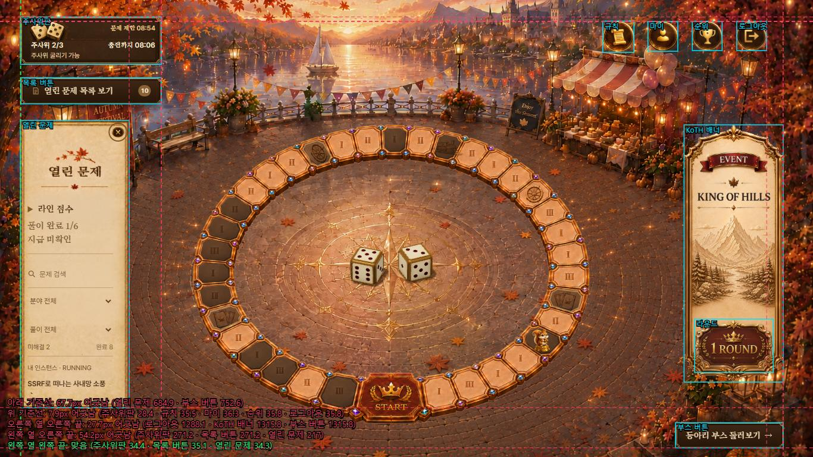 | 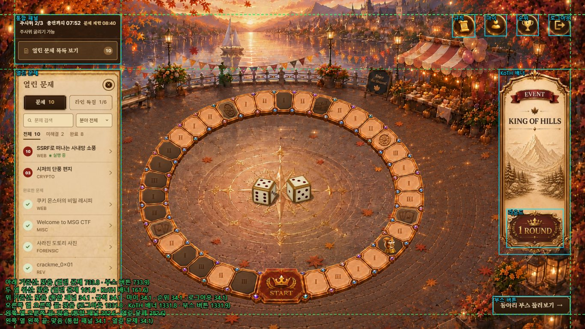 |

초록 점선은 맞은 선, 빨간 점선은 어긋난 선이다

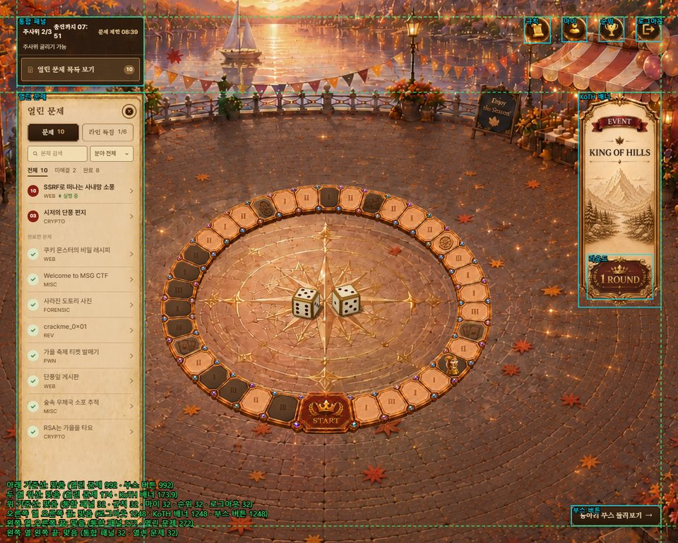

## 2026-10-23 · 열린 문제 패널

라인 점수 표, 검색, 내 인스턴스, 문제 목록이 한 종이에 섞여 읽기 어려웠다 제목 줄 > 탭 > 검색 > 목록 순서로 다시 짜고 장식은 덜어냈다

- 큰 제목 그림 대신 제목 한 줄과 닫기를 같은 줄에 두었다 1920x1080 에서 제목 부분이 186px 에서 85px 로 줄었다
- 문제 목록과 라인 독점을 탭 두 개로 나눴다 한 번에 하나만 보이고 좌우 화살표, Home, End 로 오간다 문제 탭으로 돌아오면 목록 위치가 그대로다
- 문제 줄은 번호 도장, 제목, 분야만 둔다 푼 문제는 옅은 초록 원과 체크로 바꿔 완료한 문제 묶음으로 내렸다
- 실행 중인 내 인스턴스는 그 문제 줄에 작은 초록 점과 실행 중 글자로 표시하고, 검색이나 필터로 가려졌을 때만 목록 위에 바로가기를 띄운다
- 라인 독점 탭의 줄은 문제 줄과 같은 모양이다 번호 도장은 보드 독점 띠와 같은 보석색, 이름 아래에 대상 칸 번호를 쓰고 푼 칸만 보석색으로 진하게, 오른쪽에 진행을 둔다
- 배점과 획득 점수는 값이 있을 때만 쓴다 지금처럼 지급 확인 응답이 없으면 미정, 확인 중을 줄마다 반복하지 않고 요약 칸과 안내 한 줄로만 알린다

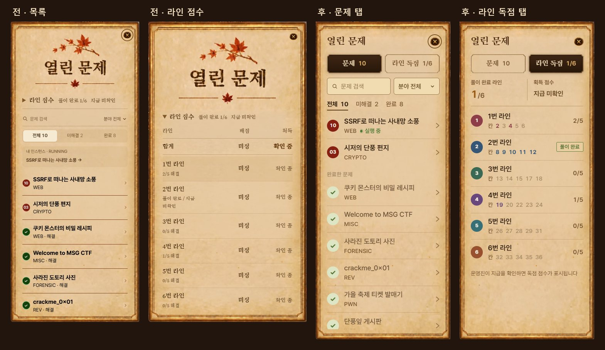

### 데스크톱과 휴대폰이 같은 모양

데스크톱 패널과 휴대폰 시트는 같은 종이 테두리, 제목 줄, 탭, 검색칸, 줄 모양을 쓰고 기준 글자 크기만 다르다

- 종이(open-challenges-paper.webp)는 원본 패널에서 제목 장식을 뺀 네 변 테두리 종이다 9분할로 늘려 패널 폭이 달라도 테두리가 찌그러지지 않는다
- 고른 탭은 열린 문제 목록 버튼과 같은 나무 명판(panel-frame.png), 안 고른 탭은 같은 명판에서 나무 면을 뺀 금테(panel-frame-outline.png)다
- 검색칸과 분야 칸은 문제 상세의 플래그 입력칸과 같은 색과 테두리, 풀이 상태는 글자와 밑줄로 고른다
- 글꼴은 제목과 탭만 Song Myung, 나머지는 모두 Pretendard 다 번호 도장은 Figma 배지의 적갈색 단색 원이다
- 데스크톱은 패널 폭에 비례하는 기준 글자(1920x1080 에서 약 18px, 1366x768 에서 약 13px) 하나를 따라 창 크기를 바꿔도 구성이 그대로다 아주 좁은 화면에서만 12px 아래로 내려가지 않게 막았다 휴대폰은 16px 로 고정한다
- 데스크톱 패널 폭은 세 플레이트와 같은 max(18.2%, 240px) 다
- 손가락 기기는 스크롤바 자리를 비우지 않아 목록 끝선이 탭, 검색 줄과 같다 입력칸 글자는 iOS 확대를 막으려고 16px 이다

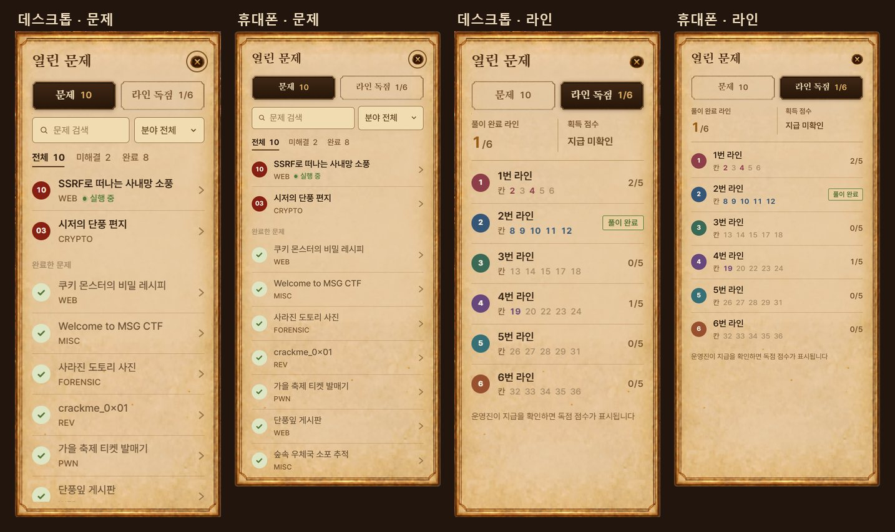

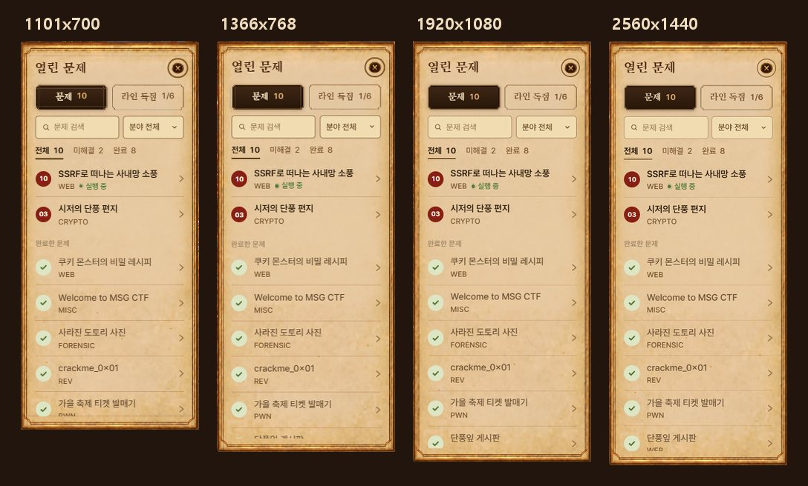

### 패널 안쪽 끝선

패널 안에서도 세로 끝선 네 개를 맞췄다 문제 탭과 라인 독점 탭을 오가도, 휴대폰 시트에서도 글 열과 아이콘 열이 같은 자리에 있다

- 왼쪽 끝선(파랑): 제목, 탭, 검색 줄, 풀이 상태, 번호 도장, 완료한 문제, 라인 요약
- 오른쪽 끝선(분홍): 닫기, 탭, 검색 줄, 화살표, 라인 진행
- 글 열(초록): 문제 제목, 분야, 라인 이름, 대상 칸
- 아이콘 열(노랑): 두 탭의 번호 도장 가운데

눌렀을 때와 보드에서 고른 라인의 바탕은 양옆으로 조금 넓혀 그려서 바탕이 생겨도 글자 끝선은 움직이지 않는다

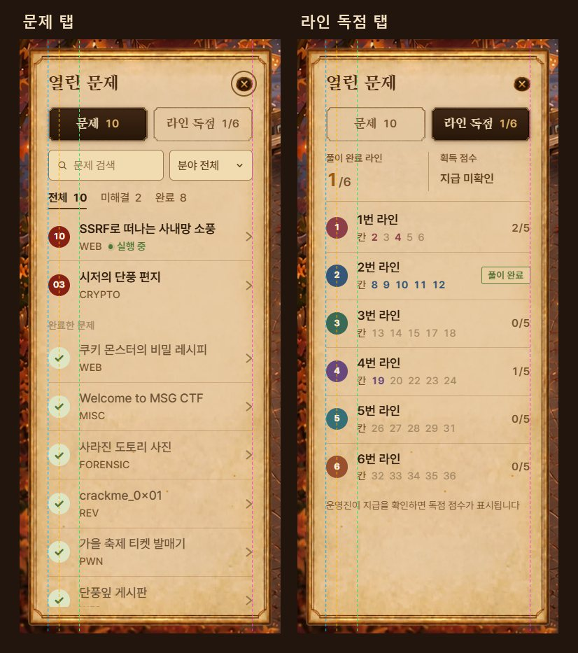

## 2026-10-24 · 문제가 여럿인 부스

main 에서 부스 메뉴판이 바로 제출로 바뀌고 상세 페이지가 빠졌는데, 메뉴판은 그 부스의 첫 문제만 보여서 목 데이터의 SWING, CodeCure 처럼 문제가 둘인 부스는 둘째 문제를 열 길이 없었다

- 문제가 여럿인 부스는 MENU 자리에 메뉴 단추를 두고 아직 못 푼 문제부터 연다 푼 메뉴에는 체크를 단다
- 메뉴 단추 줄은 MENU 줄과 높이를 맞춰 설명이 더 가려지지 않게 했고 누르는 자리만 넓혔다
- 정답이면 축제장 목록을 비우지 않고 다시 읽어 부스 진행과 메뉴 체크를 바로 바꾼다
- 메뉴를 바꾸면 초점은 고른 메뉴 단추에 남는다 메뉴를 바꾸거나 불러오는 동안, 정답을 낸 뒤에도 메뉴판이 제자리에 있어 메뉴 단추가 움직이지 않는다
- 관리자 시그니처 미리보기도 고른 문제를 먼저 보이고 메뉴를 바꿔 볼 수 있다

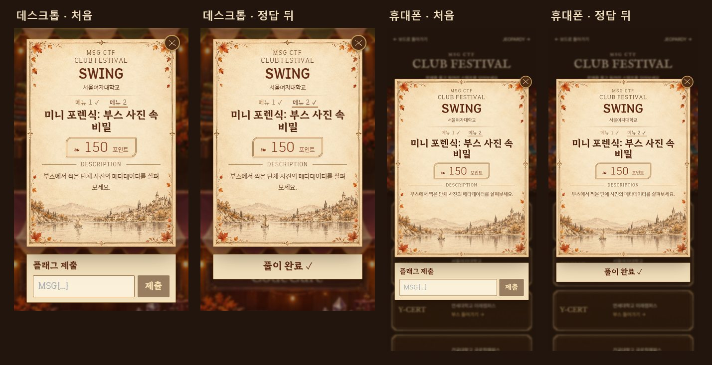

## 2026-10-24 · 부스 메뉴판 설명

main 의 메뉴판은 3:4 로 고정이라 데스크톱 300px 폭에서는 설명이 한두 줄만 보였고, 제목이 세 줄인 부스는 설명이 아예 가려져 메뉴판 안을 스크롤해야 했다

- 메뉴판은 3:4 보다 작아지지 않고 설명 길이만큼 아래로 늘어난다
- 종이 그림은 위 장식과 아래 풍경을 원래 비율로 두고 가운데 빈 종이 띠만 늘인다
- 위 자리는 3:4 메뉴판과 제출 칸이 화면 가운데 오는 자리로 고정하고 아래로만 늘어난다
- 화면 안에서 더 늘어날 수 없을 때만 설명 칸 안에서 스크롤하고 제출 칸은 늘 화면 안에 있다 1920x1080 에서는 설명 칸이 271px 에서 530px 까지 늘어난다

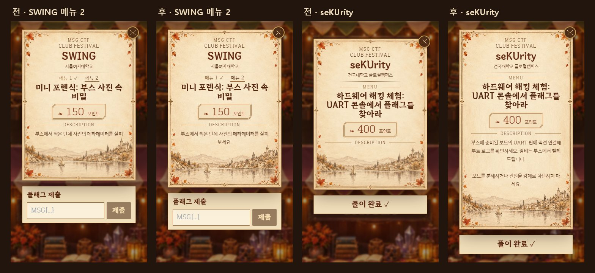

## 2026-10-23 · 보드 위 종이 창

주사위 결과 확인, 카드 폐기, 기차여행 확인, 황금열쇠, 휴대폰 룰렛이 각자 다른 흰 상자와 단추를 쓰고 있었다 열린 문제 패널과 같은 종이, 제목, 닫기 그림, 명판 단추로 맞췄다

- 창은 원판 가운데에 두고 기준 글자는 왼쪽 열 폭을 따라 열린 문제 패널과 같은 비율로 커지고 작아진다
- 실행하는 단추는 나무 명판, 다른 고르기는 금테 명판이다 고르기 동그라미도 종이 색에 맞춰 그렸다
- 황금열쇠 카드는 다른 창과 같은 닫기 그림을 쓰고 카드 아래 확인 명판으로도 닫는다 큰 화면에서는 카드를 키웠다
- 휴대폰 룰렛은 같은 종이를 쓴다 데스크톱 룰렛은 Figma 그림 그대로다
- 기차여행으로 갈 수 있는 칸은 금빛으로 밝히고 천천히 숨 쉬게 했다 움직임 줄이기 설정에서는 멈춘다
- 보유 찬스카드는 Figma 플레이트의 어두운 모양을 그대로 쓴다

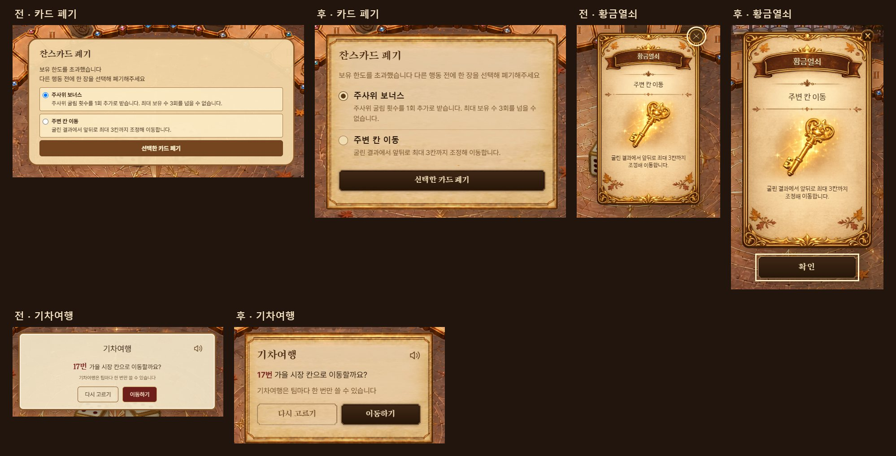

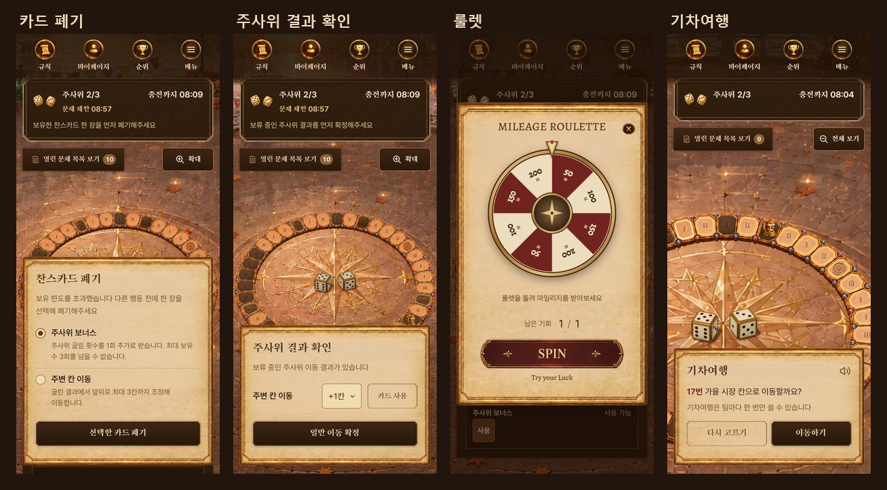

## 2026-10-23 · 인스턴스 생성 대기

생성 단추를 누른 직후부터 실행 중이 될 때까지 요청 접수, 서버 배정, 환경 준비 단계를 보이고 지금 단계에서 돈다
진행 막대에 빛이 지나가고 상태 점이 깜빡이며 기다린 시간을 1초마다 센다 인스턴스 응답에 생성 시각이 없어 화면에서 기다리기 시작한 때부터 센다
재시작과 초기화도 같은 방식으로 기다리는 표시를 보이고, 움직임 줄이기 설정에서는 돌거나 지나가지 않고 지금 단계만 밝힌다

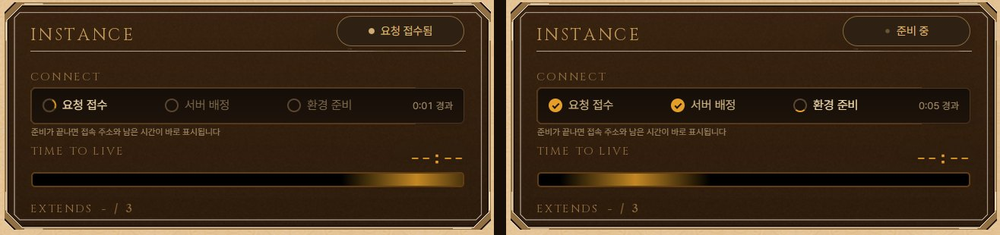

## 검사

scripts/qa-board-guides.js 가 1920x1080, 1366x768, 1280x1024, 2560x1080 에서 보이는 끝선을 재고 선을 그린 캡처를 남긴다 왼쪽 열, 오른쪽 열, 위 여백선, 두 열 위선, 아래 여백선 중 한 묶음 안에서 1px 넘게 어긋나면 실패한다
scripts/qa-open-panel-guides.js 는 열린 문제 패널의 두 탭을 열어 안쪽 끝선 네 개와 탭 사이 글 열, 아이콘 열을 같은 방식으로 잰다
둘 다 로그인한 /challenges 화면에서 playwright-cli run-code --filename 으로 실행한다
