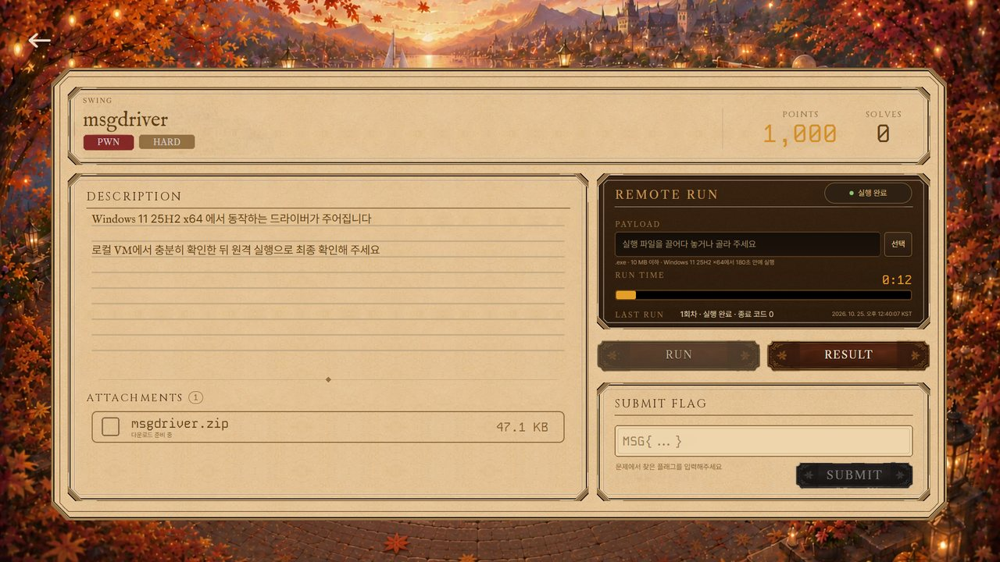
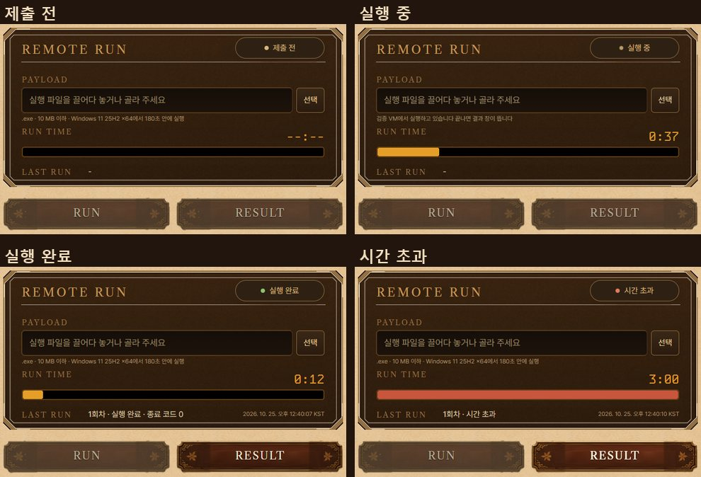
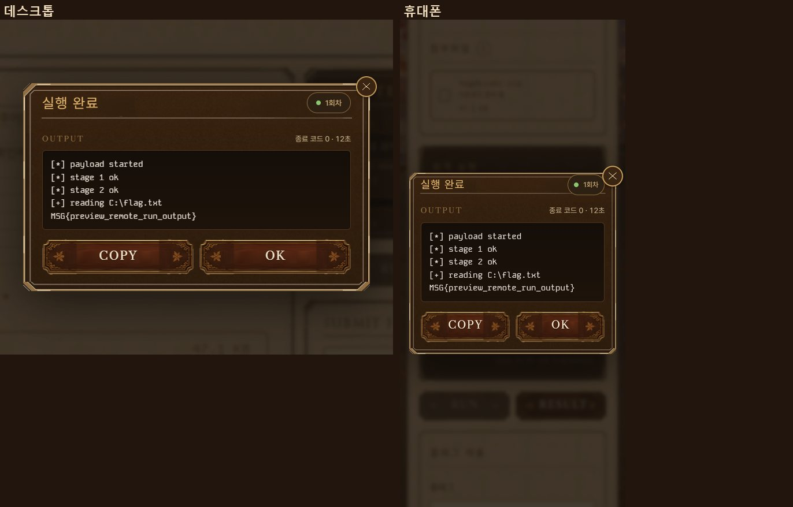
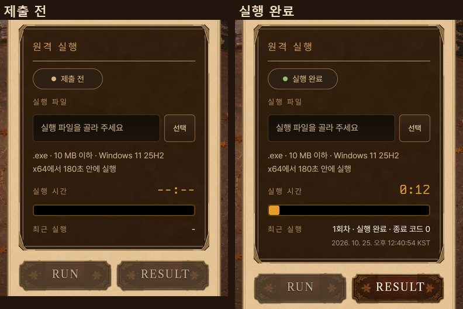
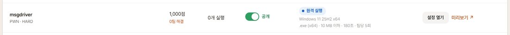
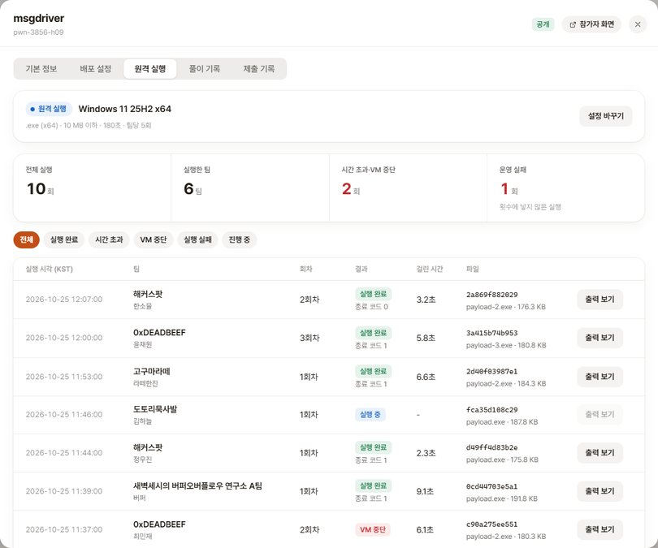
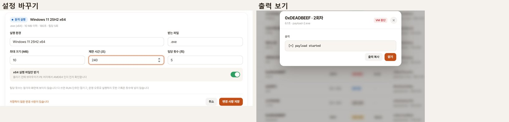

# 윈도우 문제 원격 실행

참가자에게 VM을 주지 않는 윈도우 문제는 참가자가 실행 파일을 내면 검증 VM에서 한 번 돌리고 출력을 문제 화면에 보여준다
제한값 기준은 2026_MSG_CTF pwn-msgdriver 의 vm-manifest.yaml submission 값이다 (.exe x64, 10 MB, 180초, 팀당 5회)
화면 캡처는 목 서버와 개발 미리보기 데이터다

## 참가자 문제 화면

- 문제 상세 응답에 remote_run 이 있으면 인스턴스 판 자리에 원격 실행 판을 둔다 판 크기와 자리, 상태 알약, 입력 칸, 안내 줄, 시간 값, 막대는 인스턴스 판과 같은 클래스를 쓴다
- 판 그림은 인스턴스 판 그림에서 글자만 지운 panel-run-base.png 다 PAYLOAD, RUN TIME, LAST RUN 라벨은 원래 CONNECT, TIME TO LIVE, EXTENDS 자리에 둔다
- PAYLOAD 칸에 실행 파일을 끌어다 놓거나 선택으로 고른다 확장자, 크기, x64 PE 머리를 올리기 전에 브라우저에서 먼저 확인한다
- RUN TIME 은 도는 동안 지난 시간, 끝나면 걸린 시간이고 막대는 제한 시간 대비다 시간 초과와 VM 중단은 막대가 붉다
- LAST RUN 은 최근 실행의 회차, 결과, 종료 코드와 끝난 시각이다
- 판 아래에는 인스턴스 단추와 같은 나무 판으로 RUN, RESULT 를 둔다 양 끝 장식은 늘이지 않는다
- 실행이 끝나면 결과 창이 뜨고 RESULT 로 다시 연다 결과 창은 같은 어두운 판에 결과, 회차, 출력, 오류 출력, COPY, OK 를 둔다
- 팀 제출 횟수는 참가자 화면에 보이지 않는다 다 쓰면 RUN 만 잠긴다
- 휴대폰은 인스턴스 칸처럼 한글 제목 아래로 차례대로 쌓는다

## 관리자

- 문제 목록 배포 칸에 원격 실행 알약과 실행 환경, 받는 파일 제한을 보인다
- 관리 창에 원격 실행 탭을 둔다 설정 카드는 평소 한 줄 요약이고, 설정 바꾸기로 실행 환경, 받는 파일, 최대 크기, 제한 시간, 팀당 횟수, x64 실행 파일만 받기를 고친다
- 실행 기록은 전체 실행, 실행한 팀, 시간 초과와 VM 중단, 운영 실패 요약과 결과 고르기, 팀, 회차, 결과, 걸린 시간, 파일 해시, 출력 보기를 둔다 운영 실패는 횟수에 넣지 않는다
- 배포 설정은 원격 실행 문제에서 이미지 등록 대신 원격 실행 탭을 가리킨다
- 참가자 화면 미리보기는 원격 실행도 막고 파일 칸에 미리보기에서는 실행할 수 없다고 적는다

## 백엔드 요청 (프론트 제안)

- GET /challenges/{id}, GET /admin/challenges, GET /admin/challenges/{id} 에 remote_run: environment, accept[], executable(pe-amd64), max_file_bytes, timeout_seconds, max_attempts, used_attempts(참가자만)
- 참가자 실행 기록 GET /challenges/{id}/remote_runs, 실행 요청 POST /challenges/{id}/remote_runs (multipart file 하나)
- 실행 기록 status 는 QUEUED, RUNNING, COMPLETED, TIMED_OUT, CRASHED, FAILED, REJECTED 이고 counted 로 횟수에 넣었는지 알린다 운영 오류(FAILED)와 파일 거절(REJECTED)은 넣지 않는다
- 관리자 실행 기록 GET /admin/challenges/{id}/remote_runs?status=&page=&size= 는 summary(total, teams, timed_out, crashed, failed), runs[], total_count 를 준다 status=ACTIVE 는 대기와 실행 중이다
- 관리자 설정 PATCH /admin/challenges/{id}/remote_run 은 environment, accept[], executable, max_file_bytes, timeout_seconds, max_attempts 를 받는다

## 남은 일

- 참가자 실행 파일 올리기와 실행 기록 조회는 백엔드 API가 생기면 붙인다 지금 실제 문제 화면에서는 원격 실행 판이 잠긴 채로 보인다
- 개발 서버의 /dev/remote-run-preview 에서 상태를 바꿔 보고, 파일을 골라 RUN 을 누르면 올리기부터 결과 창까지 흉내 낸다
