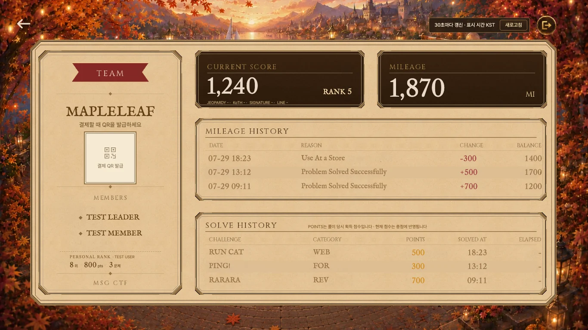

# QR / mileage text: subtle contrast review

## Before

## After

## Changed

- QR hint/status: `#775b33` → `#6f532e` (RGB 119/91/51 → 111/83/46).
- Disabled QR button **text only**: `#9a8668` → `color-mix(in srgb, #9a8668 90%, var(--brown))`. Icon and disabled behavior unchanged.
- Mileage table inherited text: `var(--ink-soft)` → scoped `color-mix(in srgb, var(--ink-soft) 85%, var(--brown))`.
- Shared tokens, positive/negative amount colors, solve-history text, typography, positions and dimensions unchanged. No claim of full WCAG/Hallmark conformance; this is an intentionally small ink adjustment.

## Target detail

QR/team region: [before](before-qr-1366.webp) / [after](after-qr-1366.webp)

Mileage region: [before](before-mileage-1366.webp) / [after](after-mileage-1366.webp)

## Visual verification

- Same route `/mypage?preview=mypage`, fixture, fixed time, reduced-motion state, scroll position 0 and browser zoom 100%.
- 1920×1080: [before](before-1920.webp) / [after](after-1920.webp).
- 1366×768: images above. 390×844: [before](before-390.webp) / [after](after-390.webp).
- Opened and visually compared both target regions and the mobile image. Parchment, palette, frames and alignment remain natural; no excessive darkening observed.
- Measured team-card, QR, personal-rank and other observed bounds/font sizes: **0 changes** at all three widths. Raw results: [before](before-measurements.json) / [after](after-measurements.json).
- Sample names are anonymized. No actual account, payment QR, credential, or API mutation is used. Browser API responses are local fixtures.
- Frontend CSS and one focused regression test only; no API/game logic or original asset changes.
