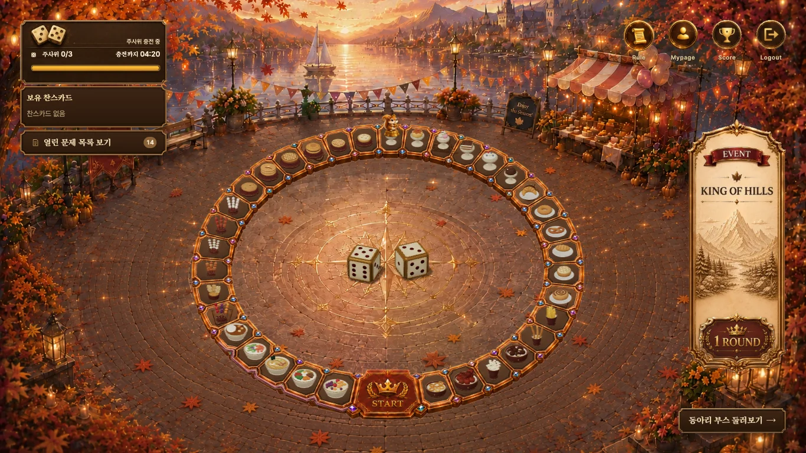

# Dice HUD numbers: +1px desktop review

## Before

## After

## Changed

Only `.stage .leftPanelCard .diceReadout strong` inside the existing `@media (min-width: 1101px)`:

- Numeric font-size: inherited `1em` → `calc(1em + 1px)`.
- Numeric inline line-height: `1` to keep the existing parent line box instead of enlarging the HUD row.
- 1366×768 computed numeric size **11→12px**; 1920×1080 **15.36→16.36px**.
- Mobile 390×844 remains **16px**. Words, navigation captions, problem-limit labels, fonts/weights, frames, parent coordinates, slot proportions and all game state/handlers are untouched.

## Target detail

## Visual verification

- Same `/board`, mocked GET data, device metrics, zoom 100%, scroll and reduced-motion state. Date **and monotonic clock** are frozen only in the QA browser so countdown text is identical before/after. Production timer code unchanged.
- 1920×1080: [before](before-1920.webp) / [after](after-1920.webp).
- 390×844: [before](before-390.webp) / [after](after-390.webp); [zoom before](before-zoom-390.webp) / [after](after-zoom-390.webp).
- 0/3 with 00:09: [1366 before](before-state-0-1366.webp) / [after](after-state-0-1366.webp); [mobile before](before-state-0-390.webp) / [after](after-state-0-390.webp).
- 1/3 with long 1:39:59 timer (existing formatter): [1366 before](before-state-1-1366.webp) / [after](after-state-1-1366.webp); [mobile before](before-state-1-390.webp) / [after](after-state-1-390.webp).
- 3/3, recharge hidden by the real component: [1366 before](before-state-3-1366.webp) / [after](after-state-3-1366.webp); [mobile before](before-state-3-390.webp) / [after](after-state-3-390.webp).
- Opened and compared full/cropped desktop and mobile/zoom screenshots. No new overlap, clipping, frame collision or disproportionate emphasis observed.
- Numeric readout **x/y/width/height unchanged in all 10 matched states**. Text strings match in every pair. [Before measurements](before-measurements.json) / [after](after-measurements.json).
- No runtime errors. Mock data selected by local-only fixture cookies, no real server requests or dice consumption. No actual dice-roll mutation test was performed; existing game regression tests run separately.
- No landmark/GLB/squirrel/Rail/model/API/timer modifications. No PR 1/2 changes included.
