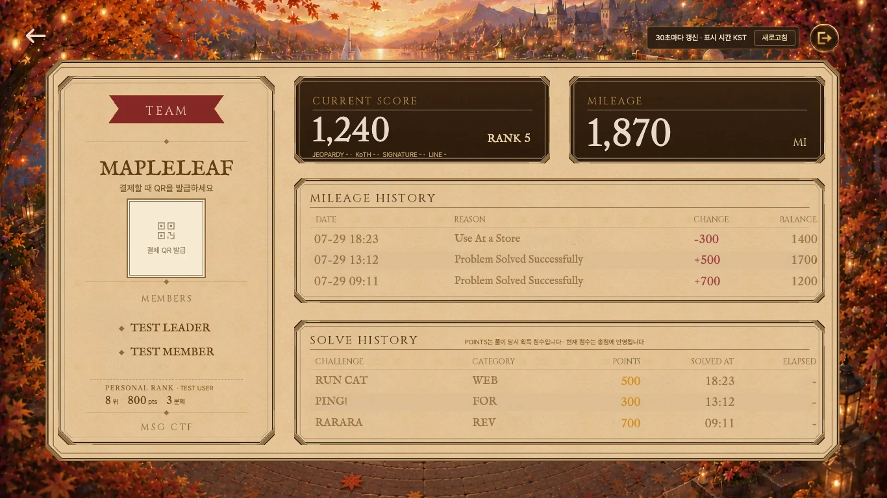

# Small rank / score labels: minimal size review

## Before

## After

## Changed

Desktop lower bounds only:

| Selector | Before | After |
|---|---|---|
| personalRank h2 | max(9px, 12u) | max(10px, 12u) |
| personalStats small | max(9px, 12u) | max(10px, 12u) |
| personalMessage | max(9px, 13u) | max(10px, 13u) |
| breakdown | max(9px, 11u) | max(10px, 11u) |

Existing proportional factors, fonts, weight, colors, line-height, slot dimensions and coordinates are unchanged. `historyNote` already has a 10px floor and was not changed. No automatic 12px expansion.

## Visual verification

- Same `/mypage?preview=mypage` route, fixture, fixed time, zoom 100%, reduced motion and scroll position.
- 1920×1080: [before](before-1920.webp) / [after](after-1920.webp). Computed labels remain 12px and breakdown 11px.
- 1366×768: computed label / unit / breakdown floors 9→10px. [Rank before](before-rank-1366.webp) / [after](after-rank-1366.webp), [score before](before-score-1366.webp) / [after](after-score-1366.webp).
- 390×844: [before](before-390.webp) / [after](after-390.webp). Existing mobile label 14px / breakdown 13px unchanged.
- Long nickname and 999,999.99-point **browser-only text fixture**: [1366 before](before-stress-1366.webp) / [after](after-stress-1366.webp), [mobile before](before-stress-390.webp) / [after](after-stress-390.webp). Existing desktop ellipsis and mobile wrapping are preserved, with no new collision or out-of-card text.
- Opened target crops and mobile stress screenshots to compare them. TEAM, QR, MEMBERS, CURRENT SCORE and card/rank slot rectangles stay fixed. At 1366 the internal personal-stat text row starts 1px lower and becomes 1px shorter due to text baseline metrics; it remains within the same slot and keeps its bottom edge. No parent layout adjustment was added.
- [Raw before measurements](before-measurements.json) / [after](after-measurements.json).
- No server state changes. Sample names are anonymized, no actual QR or auth secrets. PR 1 contrast changes are not included.
